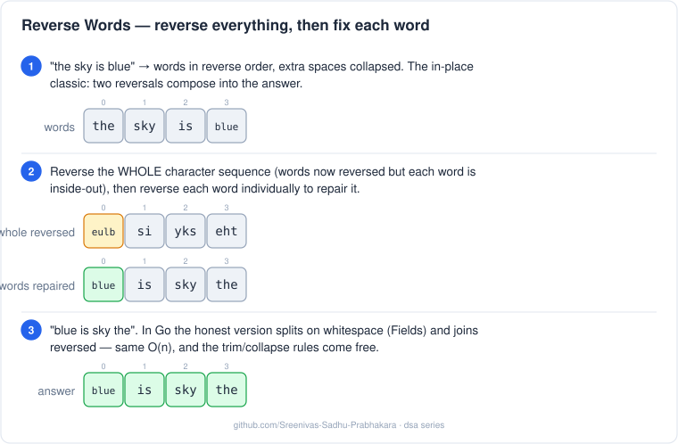

# Reverse Words in a String

> Striver SDE Sheet 092 · Day 15 String — tokenize with the stdlib, reverse the slice, join; the whitespace rules come free from Fields. Go, stdlib only, tested.

## Problem

Reverse the word order of a sentence: `"the sky is blue"` → `"blue is sky the"`, with leading/trailing whitespace dropped and inner runs collapsed to one space.

## Approach

The lazy-correct answer: `strings.Fields` already implements the messy part of the spec (split on any whitespace runs, drop empties), so the whole problem reduces to reversing a slice and joining. Knowing what the standard library makes free *is* the skill here. The in-place variant interviewers sometimes push for — reverse the whole byte array, then reverse each word, handling the space collapsing by hand — is the follow-up worth knowing conceptually; in any garbage-collected language it buys nothing.

**Complexity:** O(n) time and space.

## Visual walkthrough

Read the picture top to bottom — each numbered frame is one moment of the algorithm
running on this repo's test example.

## Run

    go test ./...   # verify
    go run .        # demo

---

One of 191 repos solving Striver's SDE Sheet in Go — stdlib only, one problem per repo, every solution tested. Browse the set: [`dsa-*` repos](https://github.com/Sreenivas-Sadhu-Prabhakara?tab=repositories&q=dsa-&type=source).
